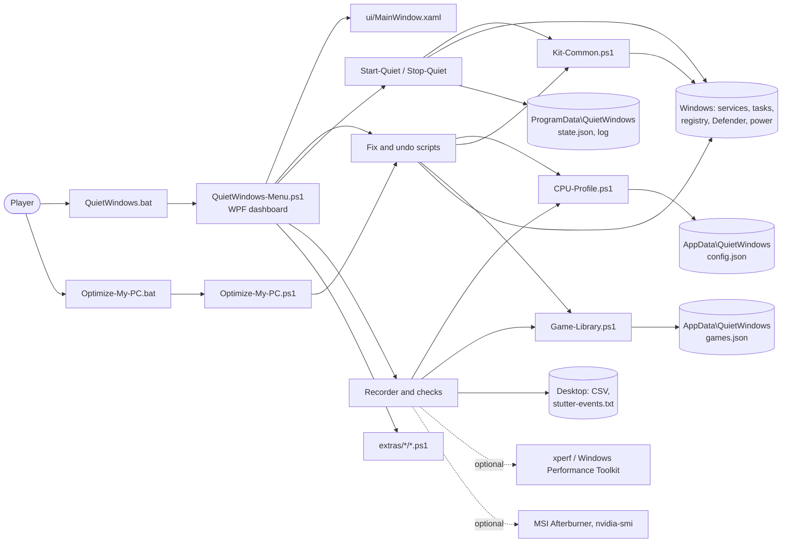

This doc describes the main parts of QuietWindows and how they connect.

## Diagram

## Parts

**Menu** (`QuietWindows-Menu.ps1`, `ui/MainWindow.xaml`). A WPF window built from the
XAML file. It detects the CPU once, shows pages of buttons, and launches each script in
its own PowerShell window, elevated when the script needs it. It does not change
Windows itself.

**One-shot setup** (`Optimize-My-PC.ps1`). The same one-time fixes as the menu's green
button, run in one elevated child window with a per-step pass or fail count.

**Session pair** (`scripts/Start-Quiet.ps1`, `scripts/Stop-Quiet.ps1`). Start disables
the quiet list and saves a snapshot; Stop replays it. See
[features/quiet-session.md](features/quiet-session.md).

**Fix and undo scripts** (`scripts/Set-*`, `Apply-*`, `Enable-*`, `Add-*`, `Undo-*`,
`Repair-*`). Each does one change and exits non-zero on real failure.

**Recorder and checks** (`Record-Session`, `Find-Stutter-Cause`, `Ready-Check`,
`Check-Quiet-Status`, `Watch-For-Reverts`, `Watch-TimerResolution`,
`Test-UndervoltStability`). Read-only tools that report.

**Libraries**. `Kit-Common.ps1` holds the version, the quiet lists, shared paths and
helpers (logging, elevation, SYSTEM hop, hard-fault helpers). `CPU-Profile.ps1` answers
"which chip is this and which cores are safe". `Game-Library.ps1` answers "which
programs and folders are games".

**Extras** (`extras/<Game>/*.ps1`). Per-game buttons discovered at run time by the menu.

## Main flow

1. The player double-clicks `QuietWindows.bat`; the menu loads the XAML and runs
   `Get-CpuProfile`.
2. **Quiet my PC down** shows any manual step (Process Lasso on dual-CCD X3D chips),
   then runs the one-time fixes elevated. The player restarts.
3. Before a game, **Quiet Windows down** runs `Start-Quiet.ps1`: snapshot, disable
   tasks, disable and stop services, pause Defender real-time, block Store auto-download.
4. After the game, **Wake Windows back up** runs `Stop-Quiet.ps1`, which replays the
   snapshot and deletes it.
5. If stutters remain, the player records a session and runs the stutter finder.

## Outside services

- **Windows** services, Task Scheduler, registry, Defender (`Set-MpPreference`),
  `powercfg`, event logs (`wevtutil`). Reached through PowerShell cmdlets and native tools.
- **Process Lasso** (Bitsum), used by hand on X3D chips; the scripts only check for it
  and give advice.
- **xperf** from the Windows Performance Toolkit, optional, for per-file hard-fault
  attribution in `Record-Session.ps1`.
- **MSI Afterburner** and **nvidia-smi**, optional GPU sensor sources for the recorder.
- No network services. Configuration is by switches and the environment variables in
  [operations.md](operations.md).

## State

- `C:\ProgramData\QuietWindows\`: `state.json` snapshot, `QuietWindows.log`,
  `storepolicy.json`, `<service>.sddl` key backups.
- `%APPDATA%\QuietWindows\`: `config.json` (CPU profile), `games.json` (games list).
- Desktop: recorder CSVs and `stutter-events.txt`.
- Registry and Windows settings changed by the fixes (see each feature doc).

Details in [data.md](data.md).
